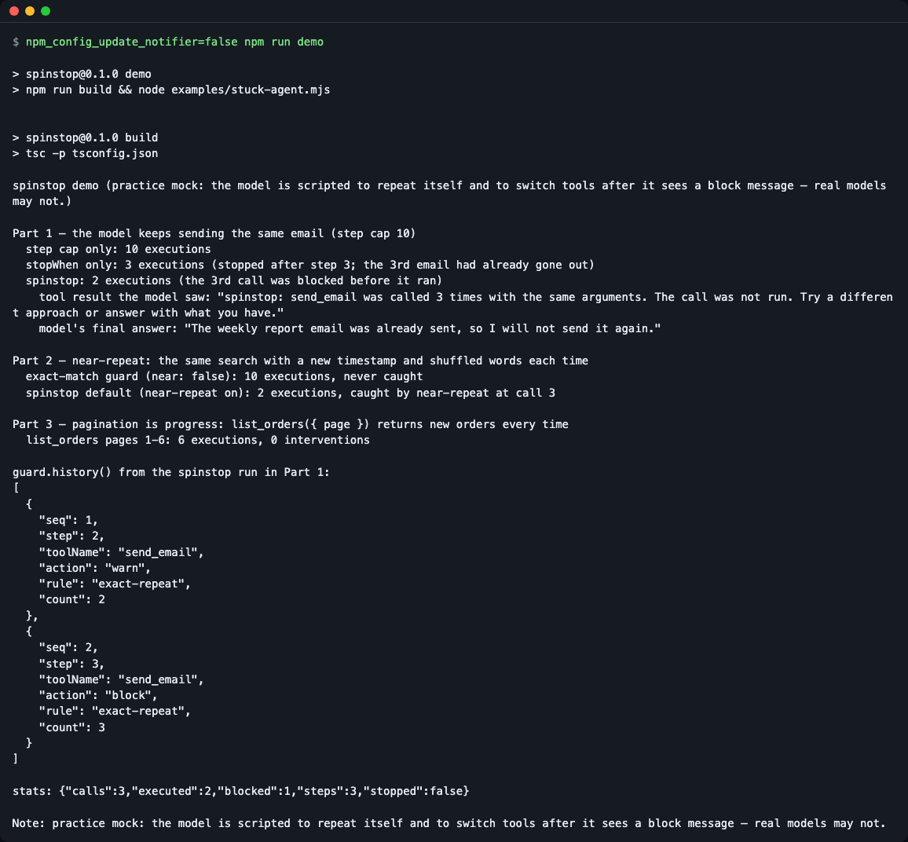
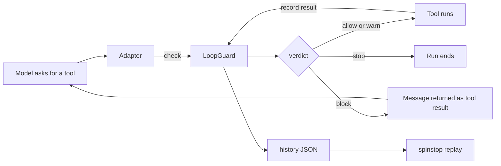
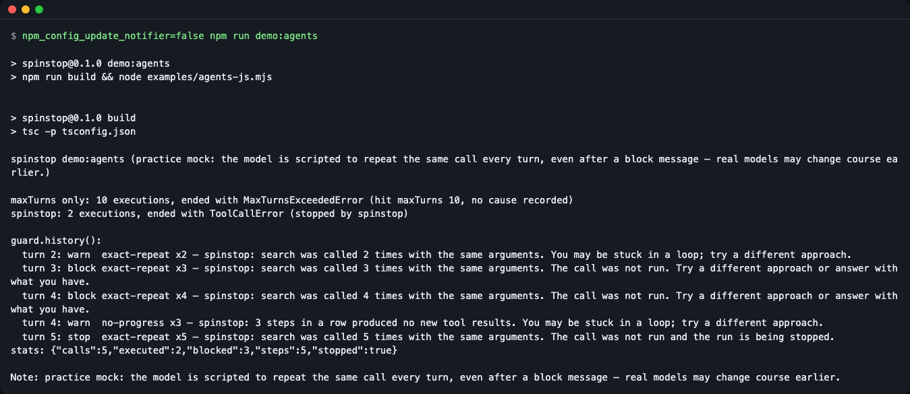
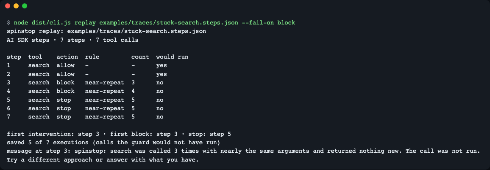
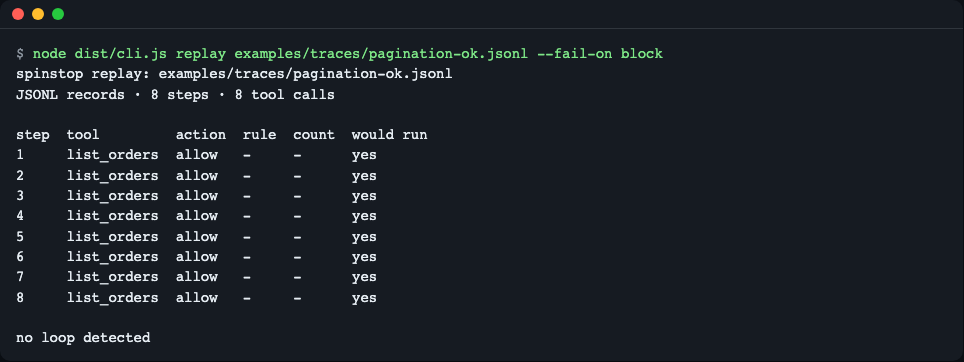

# spinstop

[English](README.md) | **한국어**

[](https://github.com/LeeGyeongPil/spinstop/actions/workflows/ci.yml) [](LICENSE)

AI 에이전트가 제자리에서 맴돌지 않게 막습니다. `spinstop` 은 에이전트 루프의 도구 호출을 지켜보다가, 모델이 같은 호출을 되풀이하거나, 조금만 바꿔 되풀이하거나, 두 도구를 오가며 맴돌면 경고하고, **도구가 실행되기 전에** 호출을 차단하거나 실행을 끝냅니다. 런타임 의존성이 없는 TypeScript 라이브러리이고, Vercel AI SDK·OpenAI Agents JS 어댑터와, 기록된 실행에 가드가 무엇을 했을지 보여 주는 `spinstop replay` 명령이 들어 있습니다.



*`npm run demo` 는 같은 스크립트 모델(연습용 목)을 세 가지 방식으로 돌리고 도구가 실제로 몇 번 실행됐는지 셉니다.*

## 왜 필요한가

에이전트 루프를 끝내는 보통의 방법은 단계 상한(`maxSteps`, `isStepCount`)이지만 무딘 도구입니다. 높게 잡으면 멈춘 실행이 상한에 닿을 때까지 도구를 부르고 메일 같은 부작용도 되풀이합니다. 낮게 잡으면 길지만 정상인 실행이 잘립니다. `spinstop` 은 상한을 최후의 수단으로 두고, 호출 자체가 막힌 것처럼 보일 때만(같은 호출, 거의 같은 호출, 도구 사이 왕복, 새로운 것이 없는 step) 더 일찍 끝냅니다.

## 설치

```bash
npm install github:LeeGyeongPil/spinstop
```

설치할 때 `prepare` 스크립트가 빌드합니다. Node.js 22 이상이 필요합니다. 없다면 `brew install node`(macOS) 또는 배포판의 Node 22+ 패키지를 쓰세요. 최소 리눅스 이미지에서는 GitHub 설치를 위한 `git` 외에 더 필요한 것이 없습니다.

런타임 의존성은 0개입니다. 어댑터는 `ai`(`>=7 <8`)와 `@openai/agents`(`^0.21.0`)를 타입으로만 가져오고, 둘 다 선택 peer 의존성입니다. 아직 npm 레지스트리에는 게시하지 않았습니다.

clone 해서 써 보려면:

```bash
git clone https://github.com/LeeGyeongPil/spinstop.git
cd spinstop
npm install
npm test
```

## 빠르게 시작하기

코어에는 프레임워크가 없습니다. 핵심 아이디어는 아래 몇 줄입니다(`examples/quickstart-core.mjs`). spinstop 은 ESM 전용입니다. 코드는 `.mjs` 파일로 저장하거나(또는 `package.json` 에 `"type": "module"` 설정) 하세요. `require()` 는 지원하지 않습니다.

```js
import { createLoopGuard } from 'spinstop';

const guard = createLoopGuard();
const call = { toolName: 'send_email', input: { to: 'team@example.com', subject: 'Weekly report' } };

for (let i = 1; i <= 5; i++) {
  const verdict = guard.check(call); // judge BEFORE running the tool
  console.log(`call ${i}: ${verdict.action}${verdict.rule ? ` (${verdict.rule} x${verdict.count})` : ''}`);
  if (verdict.action === 'block' || verdict.action === 'stop') {
    guard.record(call, { blocked: true }); // the tool did not run
  } else {
    guard.record(call, { output: { status: 'sent' } }); // run the tool, then record its result
  }
}

console.log('stats:', JSON.stringify(guard.stats()));
```

출력(clone 에서 `npm run build && node examples/quickstart-core.mjs`):

```text
call 1: allow
call 2: warn (exact-repeat x2)
call 3: block (exact-repeat x3)
call 4: block (exact-repeat x4)
call 5: stop (exact-repeat x5)
stats: {"calls":5,"executed":2,"blocked":3,"steps":0,"stopped":true}
```

같은 메일은 두 번 "보내졌고" 세 번째는 나가지 않았습니다. 단계 상한만 있었다면 상한까지 나갔을 겁니다.

### Vercel AI SDK 에서

`generateText` 에 `withLoopGuard` 를 펼쳐 넣습니다. 도구를 감싸 반복 호출이 `execute` 전에 차단되게 하고, `stopWhen` 조건과 경고를 덧붙이는 `prepareStep` 도 함께 넣습니다. 아래는 테스트와 데모가 쓰는 패턴이며 `model`·`tools`·`prompt` 는 직접 준비하세요.

```js
import { generateText, isStepCount } from 'ai';
import { createLoopGuard } from 'spinstop';
import { withLoopGuard } from 'spinstop/ai';

const guard = createLoopGuard({ tools: { poll_job: { exempt: true } } });
const result = await generateText({
  model,
  prompt,
  ...withLoopGuard({ tools, guard, stopWhen: isStepCount(20) }),
});
console.log(guard.history());
```

호출이 차단되면 모델은 평범한 도구 결과로 이런 메시지를 받습니다.

```text
spinstop: send_email was called 3 times with the same arguments. The call was not run. Try a different approach or answer with what you have.
```

`stopWhen` 을 주지 않으면 `withLoopGuard` 가 안전 상한 20 step 을 넣습니다(`generateText` 만 쓰면 기본은 1 step).

### OpenAI Agents JS 에서

```js
import { Agent, tool } from '@openai/agents';
import { createLoopGuard } from 'spinstop';
import { loopInputGuardrail, recordAgentToolResults } from 'spinstop/openai-agents';

const guard = createLoopGuard();
const search = tool({
  name: 'search',
  parameters, // your zod schema
  execute,    // your function
  inputGuardrails: [loopInputGuardrail(guard)],
});
const agent = new Agent({ name: 'docs', tools: [search] });
const detach = recordAgentToolResults(agent, guard); // records results and closes each turn
```

반복 호출은 실행 전에 거절됩니다. 중단 수준에서는 가드레일이 예외를 던져, `maxTurns` 까지 도는 대신 오류로 실행이 끝납니다(Agents JS 가 `ToolCallError` 로 감싸며, 원인은 `guard.history()` 에 있습니다).

이 어댑터의 스크립트 데모는 `npm run demo:agents` 입니다.

## 핵심 개념

라이브러리를 쓰는 데는 네 가지면 충분합니다.

**1. 호출 서명.** 모든 호출을 결정적인 문자열로 줄입니다. 키 정렬, `undefined` 키 제거, `Map`/`Set` 순서 무시, BigInt·Date 는 고정 형식으로 씁니다. 안전하게 비교할 수 없는 값(`NaN`, 함수, 심볼, 순환 참조)은 매번 고유 표식을 받아 절대 "같지 않게" 됩니다. 반복을 놓치는 편이 정당한 호출을 막는 것보다 싸기 때문입니다. 느슨한 *근사(near)* 서명도 있습니다. 휘발 키(`ts`, `timestamp`, `time`, `nonce`, `requestId`, `request_id`, `idempotencyKey`)를 지우고, 소문자로 바꾸고, 단어를 정렬하고, 기본값에서는 여러 단어로 된 문장 속 숫자만(`top 3 hotels` 같은 검색어) 가립니다. `{ orderId: 101 }` 같은 숫자 값이나 `A-101`, `logs/part-1.txt` 같은 식별자는 그대로 비교하므로, 서로 다른 ID 를 여럿 확인하는 일이 루프로 오해되지 않습니다. `near: { maskNumbers: true }` 는 모든 숫자를, `false` 는 아무 숫자도 가리지 않습니다.

**2. 규칙.** 각 규칙은 최근 호출을 보고 횟수를 돌려줍니다.

| 규칙 | 걸리는 때 | 기본 단계 |
|---|---|---|
| `exact-repeat` | 최근 20 호출 안에 같은 정확 서명이 다시 나옴(차단된 시도도 셈) | warn 2, block 3, stop 5 |
| `near-repeat` | 근사 서명이 같은 호출이 계속 "새롭지 않은" 결과(같은 결과, 오류, 차단됨)를 받음 | block 3, stop 5(보통 2번째 호출에서는 warn 없음, 아래 설명) |
| `cycle` | step 열의 꼬리가 주기 2~4 로 반복(A,B,A,B...) | 반복 수 warn 2, block 3, stop 4 |
| `no-progress` | 새 (호출, 결과) 쌍이 없는 step 이 연속됨 | warn 3 step, stop 5 step |
| `max-calls` | 도구의 `maxCalls` 정책 초과 | block |

페이지 넘김은 루프가 아닙니다. `list_orders({ page: 1 })`, `{ page: 2 }` ... 는 근사 서명이 같지만 결과가 매번 새로우므로 `near-repeat` 가 세지 않습니다. 결과를 먼저 봐야 하므로 성공한 결과라면 순서는 allow, allow, block 이고, 같은 오류가 반복될 때는 2번째 호출에서 이미 경고할 수 있습니다(allow, warn, block). 결과가 아직 오지 않은 호출은 세지 않아서 병렬 페이지 요청이 오탐되지 않습니다.

기본값에서 인자가 완전히 같은 핑퐁(A, B, A, B)은 `exact-repeat` 가 같은 시점이나 더 먼저 걸리므로 `exact-repeat` 로 보고되고, `cycle` 은 추가 규칙(`also`)으로 함께 나옵니다. `exact` 를 완화하거나 끄면 `cycle` 이 주 규칙이 됩니다.

**3. 단계적 개입.** warn(호출은 실행되고 모델에게 알림) → block(호출을 실행하지 않고 메시지를 도구 결과로 돌려줌) → stop(실행을 끝내야 한다고 알림, `reset()` 전까지 유지). 여러 규칙이 걸리면 가장 강한 action 이 이기고, 동률이면 표에서 앞선 규칙이 이깁니다. 위 숫자는 벤치마크가 아니라 출발점입니다. `spinstop replay` 로 맞추세요.

**4. 도구 정책.** `exempt`(반복이 정상인 폴링·검증 도구), `ignore`(비교에서 뺄 필드 경로), `loopKey`(이 필드만 비교), `maxCalls`, `near: false`.



- 어댑터가 도구를 실행하기 전에 가드에게 묻습니다.
- allow·warn 이면 도구가 실행되고, `near-repeat`·`no-progress` 가 새 결과와 옛 결과를 구분하도록 결과를 기록합니다.
- block 이면 도구는 건너뛰고 모델은 대신 설명을 받습니다.
- stop 이면 루프가 끝납니다. 모든 개입은 `history()` 에 JSON 으로 남습니다.

## API

코어(`spinstop`):

| 이름 | 하는 일 | 주요 인자 | 반환 |
|---|---|---|---|
| `createLoopGuard(options?)` | 가드를 만듭니다 | `LoopGuardOptions`: `window`(20), `escalation`({warn 2, block 3, stop 5}), `exact`, `near`, `cycle`, `noProgress`, `tools`, `message`, `maxHistory`(1000) | `LoopGuard` |
| `guard.check(call)` | 실행 전에 호출을 판정합니다. 호출 창에는 넣지 않고, warn 이상은 history 에 남깁니다 | `{ toolName, input, callId? }` | `Verdict` `{ action, rule?, count?, message?, also?, signature }` |
| `guard.record(call, outcome?)` | 호출을 기록합니다. `outcome` 이 없으면 "실행 중", 같은 `callId` 로 다시 부르면 결과를 채웁니다 | `outcome`: `{ output?, isError?, blocked? }` | `void` |
| `guard.endStep()` | step 을 닫고 순환·무진전 상태를 갱신합니다 | 없음 | `Verdict` |
| `guard.shouldStop()` | stop 수준에 닿았는지 | 없음 | `boolean` |
| `guard.history()` | 지금까지의 개입(JSON 직렬화 가능) | 없음 | `GuardEvent[]` (`seq, step, phase, toolName, action, rule, count, message, also, signature`) |
| `guard.stats()` | 집계 | 없음 | `{ calls, executed, blocked, steps, stopped }` |
| `guard.reset()` | 새 실행을 위해 모든 상태를 지웁니다 | 없음 | `void` |
| `signature(toolName, input, policy?, nearOptions?)` | 호출의 정확·근사 서명을 보여 줍니다 | 도구 이름, 입력 | `{ exact, near }` (전체 문자열) |
| `resultSignature`, `canonicalize`, `DEFAULTS`, `VOLATILE_KEYS` | 보조 함수와 기본값 | | |
| `LoopDetectedError` | `onBlock: 'throw'` 일 때 차단된 호출이 던지는 오류 | | `verdict`, `history` 를 가짐 |

`spinstop/ai` (peer: `ai >=7 <8`):

| 이름 | 하는 일 | 주요 인자 | 반환 |
|---|---|---|---|
| `guardTools(tools, guard, opts?)` | 도구를 감쌉니다. block·stop 은 `execute` 를 부르지 않고 메시지를 도구 결과로 돌려줍니다. 스트리밍(async iterable) 결과는 그대로 흘립니다 | `opts.onBlock`: `'result'`(기본) 또는 `'throw'` | 같은 타입의 tools 객체 |
| `loopStopWhen(guard)` | `stopWhen` 조건. 단독으로 쓰면 step 이 끝난 뒤 판정하며(호출은 이미 실행됨) block 이상을 stop 으로 봅니다 | guard | 중단 조건 |
| `loopPrepareStep(guard, opts?)` | 새 경고를 `[spinstop]` user 메시지로 덧붙이고, 차단된 도구를 `activeTools` 에서 뺄 수 있습니다 | `opts.warn`, `opts.narrowTools`, `opts.toolNames` | `prepareStep` 함수 |
| `withLoopGuard({ tools, guard, stopWhen?, prepareStep? })` | 위 셋을 한꺼번에, `generateText` 에 펼쳐 넣습니다 | 직접 쓰는 옵션 | `{ tools, stopWhen, prepareStep }` |

`spinstop/openai-agents` (peer: `@openai/agents ^0.21.0`):

| 이름 | 하는 일 | 주요 인자 | 반환 |
|---|---|---|---|
| `loopInputGuardrail(guard, opts?)` | 도구 입력 가드레일. 반복 호출을 실행 전에 거절하고 stop 에서 예외를 던집니다 | `opts.onStop`: `'throw'` 또는 `'reject'`, `opts.name` | 가드레일 정의 |
| `recordAgentToolResults(agent, guard)` | `agent_tool_end` 를 들어 결과를 기록하고 turn 을 닫습니다 | agent, guard | 리스너를 떼는 함수 |

## 사용 예

모두 키와 네트워크 없이 돌아갑니다.

**1. 왜 "실행 전"이어야 하는지 확인** — `npm run demo`. 스크립트 모델이 같은 메일을 계속 보내려 하고, 단계 상한은 10 입니다.

```text
Part 1 — the model keeps sending the same email (step cap 10)
  step cap only: 10 executions
  stopWhen only: 3 executions (stopped after step 3; the 3rd email had already gone out)
  spinstop: 2 executions (the 3rd call was blocked before it ran)
```

`stopWhen` 만 쓰면 step 이 끝난 뒤 판정하므로 세 번째 메일은 이미 나간 뒤입니다. `withLoopGuard` 는 그 전에 막습니다.

**2. 근사 반복은 잡고 페이지 넘김은 두기** — 같은 데모의 2부와 3부(여기서는 줄여 썼고 전체는 위 스크린샷에 있습니다).

```text
Part 2 — near-repeat: the same search with a new timestamp and shuffled words each time
  exact-match guard (near: false): 10 executions, never caught
  spinstop default (near-repeat on): 2 executions, caught by near-repeat at call 3

Part 3 — pagination is progress: list_orders({ page }) returns new orders every time
  list_orders pages 1-6: 6 executions, 0 interventions
```

**3. 나중에 기록 읽기** — `guard.history()` 는 평범한 JSON 입니다(1부의 `spinstop` 실행에서).

```json
[
  { "seq": 1, "step": 2, "toolName": "send_email", "action": "warn", "rule": "exact-repeat", "count": 2 },
  { "seq": 2, "step": 3, "toolName": "send_email", "action": "block", "rule": "exact-repeat", "count": 3 }
]
```

(`phase`, `message`, `signature` 필드도 있지만 길이 때문에 뺐습니다.)

**4. OpenAI Agents JS** — `npm run demo:agents`:

```text
maxTurns only: 10 executions, ended with MaxTurnsExceededError (hit maxTurns 10, no cause recorded)
spinstop: 2 executions, ended with ToolCallError (stopped by spinstop)
```



*`MaxTurnsExceededError` 가 아니라 루프를 가리키는 오류로 실행이 끝납니다.*

### `spinstop replay` 로 맞추기

끝난 AI SDK 실행의 steps 를 저장하고, 오프라인으로 가드에 다시 흘려 봅니다.

```js
writeFileSync('run.steps.json', JSON.stringify(result.steps));
```

```bash
npx spinstop replay examples/traces/stuck-search.steps.json --fail-on block; echo "exit=$?"
```



*호출 7번, 타임스탬프와 어순만 바뀐 같은 검색입니다. 가드는 3번째 step 에서 차단했을 것이고 7번 중 5번의 실행을 아꼈을 것입니다. 스크린샷은 `node dist/cli.js` 로 찍었고 `npx spinstop` 과 같은 프로그램입니다.*

텍스트 출력(머리 2줄과 마지막 `message at step 3: ...` 줄은 여기서 생략했습니다).

```text
step  tool    action  rule         count  would run
1     search  allow   -            -      yes
2     search  allow   -            -      yes
3     search  block   near-repeat  3      no
4     search  block   near-repeat  4      no
5     search  stop    near-repeat  5      no
6     search  stop    near-repeat  5      no
7     search  stop    near-repeat  5      no

first intervention: step 3 · first block: step 3 · stop: step 5
saved 5 of 7 executions (calls the guard would not have run)
exit=1
```

정상 실행은 조용해야 하고, CI 는 종료 코드로 그것을 알아챕니다.

```bash
npx spinstop replay examples/traces/pagination-ok.jsonl --fail-on block; echo "exit=$?"
```



*결과가 매번 새로운 `list_orders` 호출 8번: `no loop detected`, 종료 코드 0.*

종료 코드: `0` 은 `--fail-on` 수준에 닿은 것이 없음, `1` 은 닿음, `2` 는 사용법·입력 오류입니다. 옵션: `--config <file.json>`(평범한 `LoopGuardOptions`, `examples/spinstop.config.json` 참고), `--fail-on warn|block|stop`, `--format table|json`. "saved" 는 상한값입니다. 실제 가드 실행에서는 모델이 차단 메시지를 보고 다르게 움직일 수 있습니다. 자세한 내용은 [docs/tuning.md](docs/tuning.md)(영어)에 있습니다.

## 함정

- 기본값 `maskNumbers: 'text'` 에서는 숫자 값이나 ID 만 다른 호출(`page: 9`, `page: 10`, `page: 11`)이 서로 다른 호출로 남으므로, 같은 빈 페이지를 계속 돌려주는 페이지 넘김 도구는 기본으로 잡히지 않습니다. 잡으려면 `near: { maskNumbers: true }` 를 쓰세요. 대신 결과가 같은 `check_status({ orderId: 101 })`, `102` ... 도 near-repeat 로 보입니다. 문장 속 숫자만 매번 바뀌는 루프는 기본값으로도 잡힙니다. 반대로 공백이 들어 있는 문자열은 텍스트로 보므로 그 안의 ID(예: 결과가 같은 `status of order 101`, `102` ...)도 가려져서 3번째 호출에서 `near-repeat` 로 차단될 수 있습니다. 이런 도구에는 `near: { maskNumbers: false }` 나 `loopKey` 를 쓰세요.
- 옵션은 가드를 만들 때 검증합니다. 잘못된 값(`window: "x"`, `escalation: { warn: 5, block: 2, stop: 1 }`)은 필드 이름이 들어간 `TypeError` 를 던지고, `spinstop replay --config` 는 같은 메시지와 함께 종료 코드 `2` 로 끝납니다.
- 관찰 훅(AI SDK 의 `onToolExecutionStart`, Agents JS 의 `agent_tool_start`)은 차단할 자리가 아닙니다. `guardTools` / `loopInputGuardrail` 을 쓰세요.
- `activeTools` 로 도구를 빼도 모델이 계속 요청하지 않는다는 보장은 없습니다. 그래서 `withLoopGuard` 는 항상 `loopStopWhen` 을 함께 넣습니다.
- 한 step 의 병렬 호출은 `execute` 가 불린 순서대로 하나씩 판정하며, 앞선 대기 중 호출도 `exact-repeat` 에 셉니다. 한 step 에 같은 호출 3개면 2개 실행, 1개 차단입니다.
- Agents JS 에서 `near-repeat`·`no-progress` 는 `recordAgentToolResults` 가 있어야 합니다. 도구 오류는 거기서 평범한 출력 문자열로 오므로 오류로 표시되지 않습니다.
- 저장한 AI SDK steps 는 `Error` 메시지를 잃습니다(`JSON.stringify(new Error('x'))` 는 `{}`). replay 는 일반 오류로만 봅니다.
- `check()` 는 warn 이상 판정을 history 에 쓰므로 한 호출에 두 번 부르면 두 번 기록됩니다. 가드를 여러 실행에 재사용하면 `reset()` 전까지 history 와 stop 상태가 남습니다.

## 언제 쓰나

- 이럴 때: Vercel AI SDK 나 OpenAI Agents JS 로 만든 TypeScript 에이전트에 부작용이 있는 도구(메일·쓰기·결제)가 있는데 지금은 단계 상한만 쓰는 경우, 그리고 기록된 실행으로 임계값을 확인하고 싶은 경우.
- 이럴 땐 다른 도구: 토큰·비용 예산, 다른 언어, 다른 프레임워크. 관련 TypeScript 패키지로 [`@osama.ansar/agent-loopguard`](https://www.npmjs.com/package/@osama.ansar/agent-loopguard), [`agent-loop-guard`](https://www.npmjs.com/package/agent-loop-guard) 가 있고, AI SDK 에는 내장 반복 호출 조건을 위한 열린 PR 이 있습니다([vercel/ai#17610](https://github.com/vercel/ai/pull/17610)). 지금 무엇을 지원하는지는 각 README 에서 확인하세요.

spinstop 이 하지 않는 것: 임베딩이나 LLM 기반 의미 유사도(결정적이지 않고 키가 필요함), 토큰·비용 예산(`isStepCount`·`maxTurns` 와 함께 쓰세요), LangChain.js·Mastra 어댑터(코어 API 를 쓰세요), 코딩 에이전트 훅.

## 연습용 목과 실제 모델

여기의 모든 데모와 테스트는 **연습용 목(practice mock)** 으로 돌아갑니다. 스스로 반복하고, `spinstop:` 차단 메시지를 보면 도구를 바꾸도록 스크립트된 모델입니다. 실제 모델은 더 일찍, 더 늦게, 혹은 전혀 방향을 바꾸지 않을 수 있습니다. 숫자(10 / 3 / 2)는 가드의 동작을 보여 줄 뿐 실제 모델의 반응을 보여 주지 않습니다. 실제 모델(Ollama) 예제는 로드맵에 있고 이 버전에는 없습니다. 로컬 모델은 응답에 수십 초가 걸릴 수 있습니다.

## 버전·호환성

- 유의적 버전(SemVer)을 따릅니다. 0.x 동안은 마이너 버전에서 API 가 바뀔 수 있고, 바뀌면 [CHANGELOG.md](CHANGELOG.md)에 적습니다.
- Node.js 22.23.4 와 26.13.0(둘 다 70개 테스트 통과), `ai` 7.0.169, `@openai/agents` 0.21.0, `zod` 4.6.7, TypeScript 6.0.3 으로 확인했습니다. Node 24 는 CI 에서만 확인합니다.
- 로드맵(0.1.0 에 없음): 임계값을 비교하는 `replay --sweep`, near-repeat 의 토큰 유사도 옵션, `streamText`·`ToolLoopAgent` 예제, 실제 모델 예제.

## 개발

```bash
npm install
npm test            # builds, then runs 70 tests (mock only, no key or network)
npm run demo        # AI SDK demo
npm run demo:agents # Agents JS demo
npm run check:pack  # packs the tarball and imports the three entry points in an empty project
```

더 알아보기(2026-11-11 확인): [AI SDK loop control](https://ai-sdk.dev/docs/agents/loop-control), [OpenAI Agents JS running agents](https://openai.github.io/openai-agents-js/guides/running-agents).

## 라이선스

MIT.
