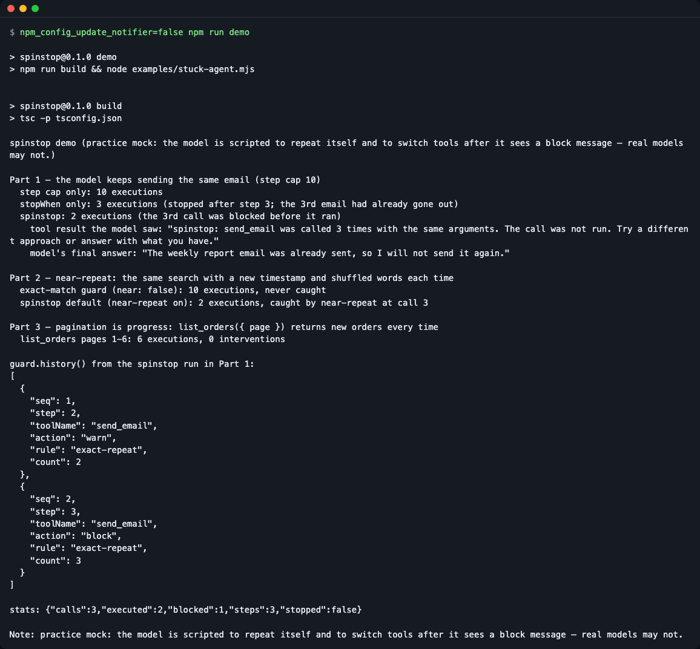
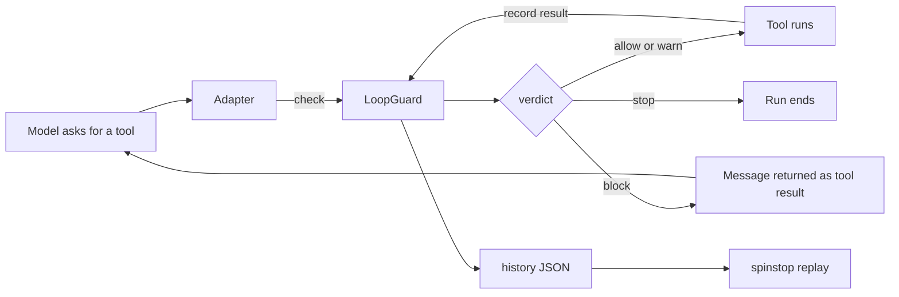
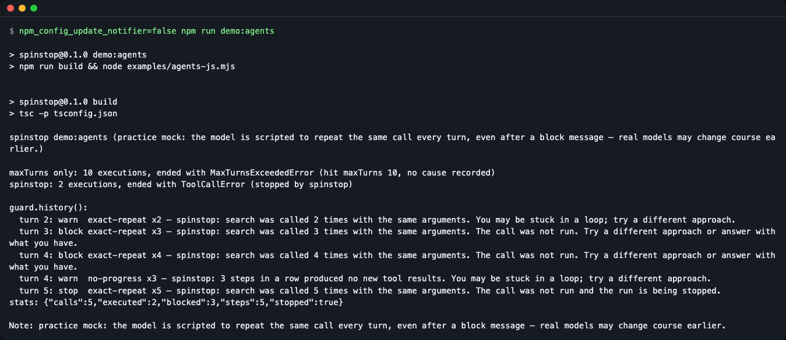
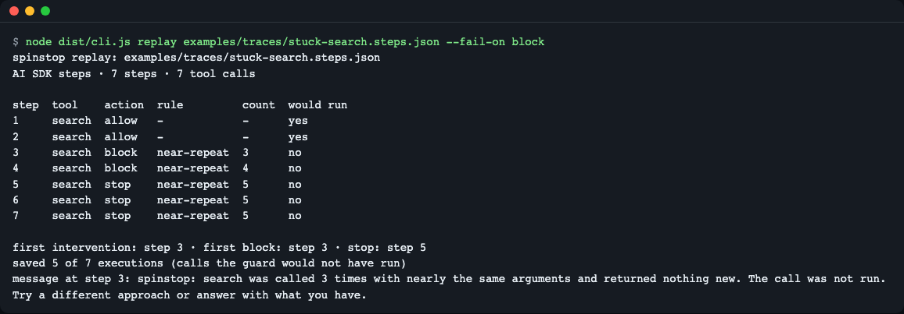
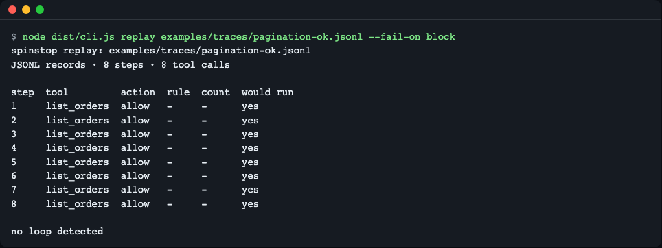

# spinstop

**English** | [한국어](README.ko.md)

[](https://github.com/LeeGyeongPil/spinstop/actions/workflows/ci.yml) [](LICENSE)

Stop AI agents from spinning. `spinstop` watches the tool calls of an agent loop and, when the model repeats the same call, repeats it with only small changes, or bounces between two tools, it warns, blocks the call **before the tool runs**, or ends the run. It is a TypeScript library with zero runtime dependencies, adapters for the Vercel AI SDK and OpenAI Agents JS, and a `spinstop replay` command that shows what the guard would have done on a recorded run.



*`npm run demo` runs the same scripted (practice mock) model three ways and counts how many times the tool really ran.*

## Why

A step cap (`maxSteps`, `isStepCount`) is the usual way to end an agent loop, but it is a blunt tool. Set it high and a stuck run keeps calling tools, and repeating side effects such as emails, until it reaches the cap. Set it low and long, healthy runs are cut off. `spinstop` leaves the cap as a last resort and ends the loop earlier only when the calls themselves look stuck: the same call, almost the same call, a back-and-forth between tools, or steps with nothing new.

## Install

```bash
npm install github:LeeGyeongPil/spinstop
```

The `prepare` script builds the package on install. Requires Node.js 22 or newer. If you do not have it: `brew install node` (macOS) or your distribution's package for Node 22+. Nothing else is needed on a minimal Linux image except `git` (for the GitHub install).

Runtime dependencies: 0. The adapters import `ai` (`>=7 <8`) and `@openai/agents` (`^0.21.0`) only as types, and both are optional peer dependencies. The package is not published to the npm registry yet.

To try it from a clone instead:

```bash
git clone https://github.com/LeeGyeongPil/spinstop.git
cd spinstop
npm install
npm test
```

## Quick start

The core has no framework in it. This is the whole idea in a few lines (`examples/quickstart-core.mjs`). spinstop is ESM only: save snippets as `.mjs` (or set `"type": "module"` in your `package.json`); `require()` is not supported.

```js
import { createLoopGuard } from 'spinstop';

const guard = createLoopGuard();
const call = { toolName: 'send_email', input: { to: 'team@example.com', subject: 'Weekly report' } };

for (let i = 1; i <= 5; i++) {
  const verdict = guard.check(call); // judge BEFORE running the tool
  console.log(`call ${i}: ${verdict.action}${verdict.rule ? ` (${verdict.rule} x${verdict.count})` : ''}`);
  if (verdict.action === 'block' || verdict.action === 'stop') {
    guard.record(call, { blocked: true }); // the tool did not run
  } else {
    guard.record(call, { output: { status: 'sent' } }); // run the tool, then record its result
  }
}

console.log('stats:', JSON.stringify(guard.stats()));
```

Output (run `npm run build && node examples/quickstart-core.mjs` in a clone):

```text
call 1: allow
call 2: warn (exact-repeat x2)
call 3: block (exact-repeat x3)
call 4: block (exact-repeat x4)
call 5: stop (exact-repeat x5)
stats: {"calls":5,"executed":2,"blocked":3,"steps":0,"stopped":true}
```

The same email was "sent" twice, never a third time. A step cap alone would have let it go out until the cap.

### With the Vercel AI SDK

Spread `withLoopGuard` into `generateText`. It wraps your tools so a repeated call is blocked before `execute` runs, adds a `stopWhen` condition, and adds a `prepareStep` that appends a warning. The code below is the pattern used by the test suite and the demo; `model`, `tools` and `prompt` are yours.

```js
import { generateText, isStepCount } from 'ai';
import { createLoopGuard } from 'spinstop';
import { withLoopGuard } from 'spinstop/ai';

const guard = createLoopGuard({ tools: { poll_job: { exempt: true } } });
const result = await generateText({
  model,
  prompt,
  ...withLoopGuard({ tools, guard, stopWhen: isStepCount(20) }),
});
console.log(guard.history());
```

When a call is blocked, the model receives a normal tool result such as:

```text
spinstop: send_email was called 3 times with the same arguments. The call was not run. Try a different approach or answer with what you have.
```

If you pass no `stopWhen`, `withLoopGuard` adds a safety cap of 20 steps (`generateText` alone defaults to one step).

### With OpenAI Agents JS

```js
import { Agent, tool } from '@openai/agents';
import { createLoopGuard } from 'spinstop';
import { loopInputGuardrail, recordAgentToolResults } from 'spinstop/openai-agents';

const guard = createLoopGuard();
const search = tool({
  name: 'search',
  parameters, // your zod schema
  execute,    // your function
  inputGuardrails: [loopInputGuardrail(guard)],
});
const agent = new Agent({ name: 'docs', tools: [search] });
const detach = recordAgentToolResults(agent, guard); // records results and closes each turn
```

Repeated calls are rejected before they run. At the stop level the guardrail throws, so the run ends with an error instead of running until `maxTurns` (Agents JS wraps it in `ToolCallError`; the cause is in `guard.history()`).

Run the scripted demo for this adapter with `npm run demo:agents`.

## Core concepts

Four ideas are enough to use the library.

**1. A call signature.** Every call is reduced to a deterministic string: keys sorted, `undefined` keys dropped, `Map`/`Set` order ignored, BigInt and Date written in a fixed form. Values that cannot be compared safely (`NaN`, functions, symbols, circular references) get a unique mark each time, so they are never "the same". A missed repeat is cheaper than blocking a legitimate call. There is also a looser *near* signature that drops volatile keys (`ts`, `timestamp`, `time`, `nonce`, `requestId`, `request_id`, `idempotencyKey`), lower-cases text, sorts words and, by default, masks numbers only inside multi-word text (a search phrase like `top 3 hotels`). Numeric values and identifiers such as `{ orderId: 101 }`, `A-101` or `logs/part-1.txt` are compared as they are, so checking many different IDs is not mistaken for a loop. `near: { maskNumbers: true }` masks every number; `false` masks none.

**2. Rules.** Each rule looks at recent calls and returns a count.

| Rule | Fires when | Default levels |
|---|---|---|
| `exact-repeat` | the same exact signature appears again within the last 20 calls (blocked attempts count too) | warn 2, block 3, stop 5 |
| `near-repeat` | calls with the same near signature keep returning results that are not new (same result again, an error, or a blocked call) | block 3, stop 5 (usually no warn on the 2nd call, see below) |
| `cycle` | the tail of the step sequence repeats with period 2 to 4 (A,B,A,B...) | repeats: warn 2, block 3, stop 4 |
| `no-progress` | whole steps in a row produce no new (call, result) pair | warn 3 steps, stop 5 steps |
| `max-calls` | a tool's `maxCalls` policy is exceeded | block |

Pagination is not a loop: `list_orders({ page: 1 })`, `{ page: 2 }` ... share a near signature, but each result is new, so `near-repeat` does not count them. Because it must see the result first, with successful results the sequence is allow, allow, block, while a repeated error can already warn on the 2nd call (allow, warn, block). A call whose result is still pending is not counted, so parallel page requests are not flagged.

With default settings, an exact-argument ping-pong (A, B, A, B) is reported as `exact-repeat` because that rule fires at the same moment or earlier; `cycle` is listed as an additional rule (`also`). It becomes the main rule when you relax or turn off `exact`.

**3. Escalation.** warn (the call runs, the model is told) then block (the call does not run, the model gets a message as the tool result) then stop (the guard says the run should end; `stop` stays on until `reset()`). When several rules fire, the strongest action wins; ties go to the rule listed first in the table. The numbers above are a starting point, not a benchmark result. Tune them with `spinstop replay`.

**4. Tool policies.** `exempt` (polling or verification tools that may repeat), `ignore` (field paths to leave out of comparison), `loopKey` (compare only these fields), `maxCalls`, and `near: false`.



- The adapter asks the guard before the tool runs.
- On allow or warn the tool runs, and its result is recorded so `near-repeat` and `no-progress` can tell new results from old ones.
- On block the tool is skipped and the model sees an explanation instead.
- On stop the loop ends. Every intervention is kept in `history()` as JSON.

## API

Core (`spinstop`):

| Name | What it does | Main arguments | Returns |
|---|---|---|---|
| `createLoopGuard(options?)` | Creates a guard | `LoopGuardOptions`: `window` (20), `escalation` ({warn 2, block 3, stop 5}), `exact`, `near`, `cycle`, `noProgress`, `tools`, `message`, `maxHistory` (1000) | `LoopGuard` |
| `guard.check(call)` | Judges a call before it runs; does not add it to the call window; warn or higher goes to history | `{ toolName, input, callId? }` | `Verdict` `{ action, rule?, count?, message?, also?, signature }` |
| `guard.record(call, outcome?)` | Records a call. Without `outcome` it is "running"; the same `callId` later fills in the result | `outcome`: `{ output?, isError?, blocked? }` | `void` |
| `guard.endStep()` | Closes a step: updates cycle and no-progress state | none | `Verdict` |
| `guard.shouldStop()` | Whether stop level was reached | none | `boolean` |
| `guard.history()` | Interventions so far, JSON-serializable | none | `GuardEvent[]` (`seq, step, phase, toolName, action, rule, count, message, also, signature`) |
| `guard.stats()` | Counts | none | `{ calls, executed, blocked, steps, stopped }` |
| `guard.reset()` | Clears all state for a new run | none | `void` |
| `signature(toolName, input, policy?, nearOptions?)` | Shows the exact and near signature of a call | tool name, input | `{ exact, near }` (full strings) |
| `resultSignature`, `canonicalize`, `DEFAULTS`, `VOLATILE_KEYS` | Helpers and default values | | |
| `LoopDetectedError` | Error thrown when a call is blocked with `onBlock: 'throw'` | | has `verdict` and `history` |

`spinstop/ai` (peer: `ai >=7 <8`):

| Name | What it does | Main arguments | Returns |
|---|---|---|---|
| `guardTools(tools, guard, opts?)` | Wraps tools: block and stop do not call `execute`; the message becomes the tool result. Streaming (async iterable) results are passed through | `opts.onBlock`: `'result'` (default) or `'throw'` | the same tools object type |
| `loopStopWhen(guard)` | A `stopWhen` condition. Used alone it judges after the step (the call already ran), and treats block or higher as stop | guard | stop condition |
| `loopPrepareStep(guard, opts?)` | Appends a `[spinstop]` user message for new warnings; can remove blocked tools from `activeTools` | `opts.warn`, `opts.narrowTools`, `opts.toolNames` | `prepareStep` function |
| `withLoopGuard({ tools, guard, stopWhen?, prepareStep? })` | All three at once, to spread into `generateText` | your options | `{ tools, stopWhen, prepareStep }` |

`spinstop/openai-agents` (peer: `@openai/agents ^0.21.0`):

| Name | What it does | Main arguments | Returns |
|---|---|---|---|
| `loopInputGuardrail(guard, opts?)` | Tool input guardrail: rejects repeated calls before they run; throws at stop | `opts.onStop`: `'throw'` or `'reject'`, `opts.name` | guardrail definition |
| `recordAgentToolResults(agent, guard)` | Listens to `agent_tool_end` to record results and close each turn | agent, guard | function that detaches the listener |

## Usage examples

All of these run without a key or a network connection.

**1. Prove why "before execution" matters** — `npm run demo`. The scripted model keeps sending the same email, with a step cap of 10:

```text
Part 1 — the model keeps sending the same email (step cap 10)
  step cap only: 10 executions
  stopWhen only: 3 executions (stopped after step 3; the 3rd email had already gone out)
  spinstop: 2 executions (the 3rd call was blocked before it ran)
```

`stopWhen` alone judges after the step, so the third email is already sent. `withLoopGuard` stops it before.

**2. Catch near-repeats and leave pagination alone** — part 2 and 3 of the same demo (output shortened here, the full text is in the screenshot above):

```text
Part 2 — near-repeat: the same search with a new timestamp and shuffled words each time
  exact-match guard (near: false): 10 executions, never caught
  spinstop default (near-repeat on): 2 executions, caught by near-repeat at call 3

Part 3 — pagination is progress: list_orders({ page }) returns new orders every time
  list_orders pages 1-6: 6 executions, 0 interventions
```

**3. Read the history afterwards** — `guard.history()` is plain JSON (from the Part 1 run, with `spinstop`):

```json
[
  { "seq": 1, "step": 2, "toolName": "send_email", "action": "warn", "rule": "exact-repeat", "count": 2 },
  { "seq": 2, "step": 3, "toolName": "send_email", "action": "block", "rule": "exact-repeat", "count": 3 }
]
```

(Fields `phase`, `message`, `signature` are also present; they are left out here for length.)

**4. OpenAI Agents JS** — `npm run demo:agents`:

```text
maxTurns only: 10 executions, ended with MaxTurnsExceededError (hit maxTurns 10, no cause recorded)
spinstop: 2 executions, ended with ToolCallError (stopped by spinstop)
```



*The run ends with an error that points at the loop, not with `MaxTurnsExceededError`.*

### Tune with `spinstop replay`

Save the steps of a finished AI SDK run, then replay them through the guard offline:

```js
writeFileSync('run.steps.json', JSON.stringify(result.steps));
```

```bash
npx spinstop replay examples/traces/stuck-search.steps.json --fail-on block; echo "exit=$?"
```



*Seven calls, the same search with a changed timestamp and word order. The guard would have blocked at step 3 and saved 5 of 7 executions. The screenshots were taken with `node dist/cli.js`, which is the same program as `npx spinstop`.*

Text output (the two header lines and the final `message at step 3: ...` line are left out here):

```text
step  tool    action  rule         count  would run
1     search  allow   -            -      yes
2     search  allow   -            -      yes
3     search  block   near-repeat  3      no
4     search  block   near-repeat  4      no
5     search  stop    near-repeat  5      no
6     search  stop    near-repeat  5      no
7     search  stop    near-repeat  5      no

first intervention: step 3 · first block: step 3 · stop: step 5
saved 5 of 7 executions (calls the guard would not have run)
exit=1
```

A healthy run should stay quiet, and the exit code is how CI notices:

```bash
npx spinstop replay examples/traces/pagination-ok.jsonl --fail-on block; echo "exit=$?"
```



*Eight `list_orders` calls with new results each time: `no loop detected`, exit code 0.*

Exit codes: `0` nothing reached the `--fail-on` level, `1` something did, `2` usage or input error. Options: `--config <file.json>` (plain `LoopGuardOptions`, see `examples/spinstop.config.json`), `--fail-on warn|block|stop`, `--format table|json`. "Saved" is an upper bound: in a real guarded run the model sees the block message and may act differently. More in [docs/tuning.md](docs/tuning.md).

## Pitfalls

- With the default `maskNumbers: 'text'`, calls that differ only in a numeric value or an ID (`page: 9`, `page: 10`, `page: 11`) stay different, so a paging tool that keeps returning the same empty page is not caught by default. To catch that, use `near: { maskNumbers: true }`; the cost is that `check_status({ orderId: 101 })`, `102`, ... with equal results then look like near-repeats. If a loop is a number inside a sentence that changes each time, the default already catches it. The flip side: a string that contains a space is treated as text, so an ID inside it (for example `status of order 101`, `102`, ... with equal results) is masked and can be blocked as `near-repeat` at the third call. For such a tool set `near: { maskNumbers: false }` or a `loopKey`.
- Options are validated when the guard is created: a bad value (`window: "x"`, `escalation: { warn: 5, block: 2, stop: 1 }`) throws a `TypeError` that names the field, and `spinstop replay --config` exits `2` with the same message.
- Observation hooks (`onToolExecutionStart` in the AI SDK, `agent_tool_start` in Agents JS) are not a place to block. Use `guardTools` / `loopInputGuardrail`.
- Removing a tool with `activeTools` does not guarantee the model stops asking for it. `withLoopGuard` always includes `loopStopWhen` for that reason.
- Parallel calls in one step are judged one by one in the order `execute` is called, and an earlier pending call counts for `exact-repeat`. Three identical calls in one step: two run, one is blocked.
- In Agents JS, `near-repeat` and `no-progress` need `recordAgentToolResults`. Tool errors arrive there as plain output text, so they are not marked as errors.
- Saved AI SDK steps lose `Error` messages (`JSON.stringify(new Error('x'))` is `{}`), so replay sees only a generic error.
- `check()` writes warn-or-higher verdicts to history, so calling it twice for one call logs twice. Reusing a guard across runs keeps its history and stop state until `reset()`.

## When to use it

- Good fit: a TypeScript agent on the Vercel AI SDK or OpenAI Agents JS that has tools with side effects (mail, writes, payments) and today relies on a step cap only; and when you want to check thresholds against recorded runs.
- Different tools for other cases: counting tokens or cost budgets, other languages, or other frameworks. Related TypeScript packages exist, for example [`@osama.ansar/agent-loopguard`](https://www.npmjs.com/package/@osama.ansar/agent-loopguard) and [`agent-loop-guard`](https://www.npmjs.com/package/agent-loop-guard); the AI SDK also has an open pull request for a built-in repeated-tool-call condition ([vercel/ai#17610](https://github.com/vercel/ai/pull/17610)). Check their READMEs for what they cover today.

What spinstop does not do: semantic similarity with embeddings or an LLM (it is not deterministic and would need a key), token or cost budgets (use `isStepCount` or `maxTurns` with it), adapters for LangChain.js or Mastra (use the core API), coding-agent hooks.

## Practice mock and real models

Every demo and test here runs a **practice mock**: a scripted model that repeats itself and that switches tools after it sees a `spinstop:` block message. Real models may change course earlier, later, or not at all. The counts (10 / 3 / 2) show how the guard behaves, not how a real model reacts. A real-model example (Ollama) is on the roadmap, not in this version; local models can take tens of seconds per answer.

## Versions and compatibility

- Semantic Versioning. While the version is 0.x, a minor release may change the API; changes are listed in [CHANGELOG.md](CHANGELOG.md).
- Checked with Node.js 22.23.4 and 26.13.0 (all 70 tests pass on both), `ai` 7.0.169, `@openai/agents` 0.21.0, `zod` 4.6.7, TypeScript 6.0.3. Node 24 is covered by CI only.
- Roadmap (not in 0.1.0): `replay --sweep` to compare thresholds, a token-similarity option for near-repeat, `streamText` and `ToolLoopAgent` examples, a real-model example.

## Development

```bash
npm install
npm test            # builds, then runs 70 tests (mock only, no key or network)
npm run demo        # AI SDK demo
npm run demo:agents # Agents JS demo
npm run check:pack  # packs the tarball and imports the three entry points in an empty project
```

Further reading (checked 2026-11-11): [AI SDK loop control](https://ai-sdk.dev/docs/agents/loop-control), [OpenAI Agents JS running agents](https://openai.github.io/openai-agents-js/guides/running-agents).

## License

MIT.
